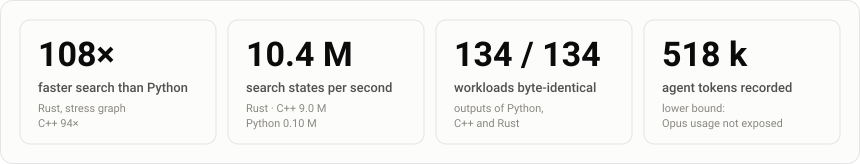
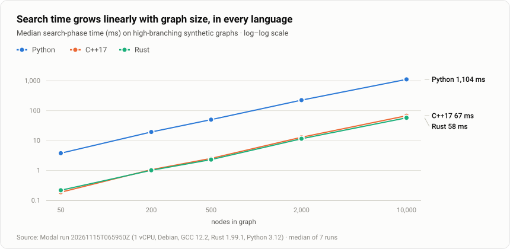
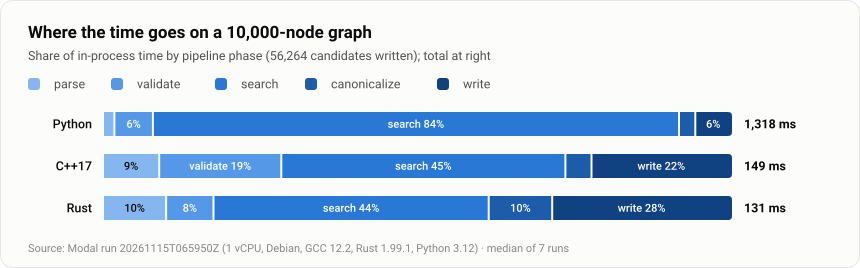
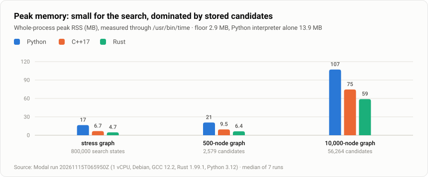
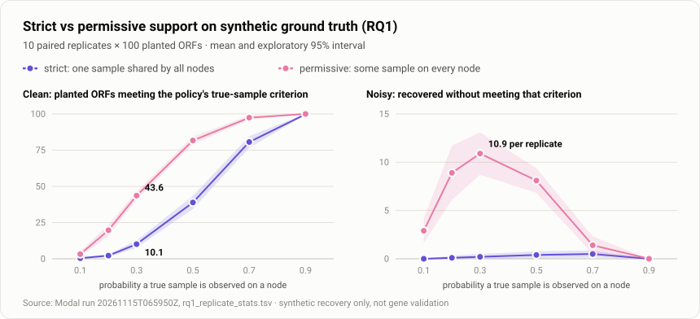
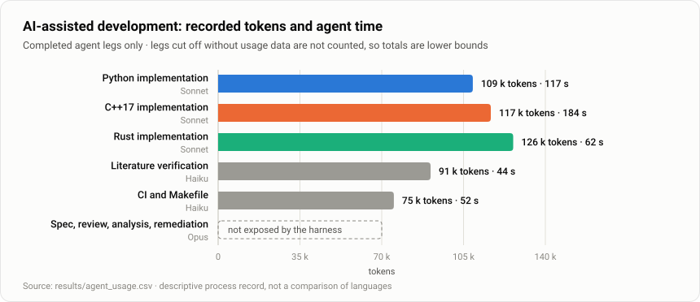

# ColorFrame

**Frame-aware candidate path search in coloured sequence graphs: a controlled algorithmic and
engineering prototype.**

[](https://github.com/AliMohammadiiii/ColorFrame/actions/workflows/ci.yml)
[](LICENSE)

Project lead: Ali Mohammadi · Status: **v1.0.1 (final)**, after two independent reviews
([remediation report](docs/remediation/REMEDIATION_REPORT.md), [rc2 review](docs/remediation/RC2_FINAL_REVIEW.md)) ·
Implementation by AI development agents under the lead's direction ([AI usage](docs/AI_USAGE.md)).

<picture>
  <source media="(prefers-color-scheme: dark)" srcset="docs/figures/hero-dark.svg">
  
</picture>

## Results at a glance

All figures are generated from the recorded results by
[`analysis/readme_figures.py`](analysis/readme_figures.py), checked against them in CI, and come
from the authoritative Modal run [`20261115T065950Z`](results/modal/20261115T065950Z) (1 vCPU,
median of 7 runs). They compare **these three implementations** on synthetic workloads; see the
[technical report](reports/TECHNICAL_REPORT.md) and [limitations](docs/LIMITATIONS.md).

**Speed.** Search time grows linearly with graph size in all three languages. The compiled
implementations are 16× (C++) and 19× (Rust) faster than Python on the largest graph.

<picture>
  <source media="(prefers-color-scheme: dark)" srcset="docs/figures/scaling-dark.svg">
  
</picture>

**Where the time goes.** In Python the search dominates (84%). In C++ and Rust the search is fast
enough that reading, validating, sorting and writing make up more than half of the run.

<picture>
  <source media="(prefers-color-scheme: dark)" srcset="docs/figures/phases-dark.svg">
  
</picture>

**Memory.** The traversal itself needs little memory; peak memory grows with the number of
candidates kept for output, and Python adds its interpreter baseline.

<picture>
  <source media="(prefers-color-scheme: dark)" srcset="docs/figures/memory-dark.svg">
  
</picture>

**Support policies (RQ1).** Requiring one sample shared by all nodes (strict) is much harder to
satisfy under sparse observation than requiring some sample on every node (permissive). Under
noise, permissive also keeps planted paths in which some node lacks true-sample support. Strict
almost never does. This is synthetic recovery, not gene validation.

<picture>
  <source media="(prefers-color-scheme: dark)" srcset="docs/figures/rq1-dark.svg">
  
</picture>

**AI-assisted development.** Recorded tokens and agent time for each completed agent task. Tasks
cut off without usage data, and all coordinator (Opus) usage, are missing, so these are lower
bounds and a process record, not a comparison of languages.

<picture>
  <source media="(prefers-color-scheme: dark)" srcset="docs/figures/tokens-dark.svg">
  
</picture>

ColorFrame enumerates forward-strand ORFs (`ATG` … first in-frame stop) along walks of a small
coloured sequence graph. It tracks the reading frame across overlaps, branches, loops and
repeats, and applies one of two sample-evidence policies:
- **strict**: one colour must be shared by every node of the walk;
- **permissive**: every node must have some colour.

Every bound that truncates the search is reported. The same algorithm is implemented in Python,
C++17 and Rust, with byte-identical outputs. It is **not** a gene caller. ggCaller already
performs frame-aware DFS ORF discovery on population-wide coloured DBGs, with FM-index path
validation ([prior art and scope](docs/PRIOR_ART_AND_SCOPE.md)).

## Results in detail (authoritative run [`results/modal/20261115T065950Z`](results/modal/20261115T065950Z), Modal 1 CPU, Linux/GCC)

- **RQ1, synthetic support-policy trade-off** (10 paired replicates; 100 planted ORFs each).
  In all 240 workload-policy runs, every planted ORF meeting the policy-specific true-sample support criterion was recovered. In noisy conditions, additional candidates could also be retained through non-true colour evidence (raw recovered count = criterion count in 182/240 runs; all 58 exceptions are noisy).
  Clean, p_true_observation = 0.3: 10.1 planted ORFs (95% CI 7.6–12.6) have a true sample shared
  by all their nodes (strict criterion), and 43.6 (40.7–46.5) have true-sample support on every
  node (permissive criterion); permissive outputs 3.5× more candidates. Noisy
  (`p_spurious = 0.25·p`): permissive also retains up to 10.9 planted paths (replicate mean) in
  which **at least one node lacks true-sample support**; strict retains ≤ 0.5 paths whose only
  all-node shared colour is non-true. None of this is gene validation.
- **RQ2/RQ3, these three implementations:** search phase vs Python, C++ 16–30× and Rust 17–42×
  faster on graph workloads, 92–108× on the stress workload; all in-process phases (`total_ms`),
  C++ 3.7–9.5× and Rust 8.6–12.4× on the perf graphs. Rust's search beats C++ on 19 of 20
  workloads. Linux peak RSS (wrapper floor 2.9 MB, Python interpreter 13.9 MB): stress C++
  6.7 MB, Rust 4.7 MB, Python 16.6 MB.
- **AI-assisted development:** a descriptive process trace with incomplete telemetry
  ([token accounting](docs/TOKEN_ACCOUNTING.md)). No effort–performance claim.

v1.0.0 search speed-ups and Modal memory figures were **invalid** (unequal timing phases; RSS
inherited from the harness) and are superseded ([`archive/v1.0.0/`](archive/v1.0.0)).

## Quick start

```bash
make test                                   # fixtures, unit tests, lint, timing/RQ1/RSS contracts, 39 cases x 3, 134-workload equivalence
modal run --detach benchmarks/modal_app.py  # authoritative benchmark + RQ1 + R analysis
```

## Repository layout

| Path | Contents |
|---|---|
| [`python/`](python), [`cpp/`](cpp), [`rust/`](rust) | the three implementations and their unit tests |
| [`fixtures/`](fixtures) | 39 hand-derived conformance cases ([FIXTURES.md](fixtures/FIXTURES.md)) |
| [`tests/`](tests) | oracle, conformance, cross-language, contract, RQ1, RSS, CLI and release checks |
| [`benchmarks/`](benchmarks) | workload generator, benchmark runner, RQ1 evaluator, Modal app |
| [`analysis/`](analysis) | R analysis (base R) |
| [`results/`](results) | raw benchmark runs and the AI-usage ledger (superseded runs are labelled) |
| [`reports/`](reports) | technical report and figures |
| [`docs/figures/`](docs/figures) | README figures (light and dark SVG), generated by [`analysis/readme_figures.py`](analysis/readme_figures.py) |
| [`docs/`](docs) | all project documentation (below) |
| [`archive/`](archive) | the v1.0.0 README and report, kept for the record |

## Documentation

**Results**
- [Technical report](reports/TECHNICAL_REPORT.md): method, results for RQ1–RQ3, limitations
- [Limitations](docs/LIMITATIONS.md)

**Specification and design**
- [Project charter](docs/PROJECT_CHARTER.md): research questions and scope
- [Algorithm specification](docs/ALGORITHM_SPEC.md) (v1.1): traversal, policies, counters, complexity
- [Input/output schema](docs/INPUT_OUTPUT_SCHEMA.md): formats, validation, error codes, timing phases
- [Architecture](docs/ARCHITECTURE.md)
- [Test plan](docs/TEST_PLAN.md) · [Fixtures](fixtures/FIXTURES.md)

**Benchmarking and reproducibility**
- [Benchmark protocol](docs/BENCHMARK_PROTOCOL.md)
- [Reproducibility](docs/REPRODUCIBILITY.md): what ran locally and what ran on Modal
- [Modal execution](docs/MODAL_EXECUTION.md)

**Literature**
- [Literature review](docs/LITERATURE_REVIEW.md) · [Prior art and scope](docs/PRIOR_ART_AND_SCOPE.md) · [References (BibTeX)](docs/references.bib)

**Process and provenance**
- [AI usage and attribution](docs/AI_USAGE.md) · [Token accounting](docs/TOKEN_ACCOUNTING.md)
- [Decision log](docs/DECISION_LOG.md) · [Task board](docs/TASK_BOARD.md) · [Changelog](CHANGELOG.md)
- Remediation records: [v1.0.1 report](docs/remediation/REMEDIATION_REPORT.md), [plan](docs/remediation/REMEDIATION_PLAN.md), [status](docs/remediation/REMEDIATION_STATUS.md), [log](docs/remediation/REMEDIATION_LOG.md); rc2 [final review](docs/remediation/RC2_FINAL_REVIEW.md), [plan](docs/remediation/RC2_REMEDIATION_PLAN.md), [status](docs/remediation/RC2_REMEDIATION_STATUS.md), [log](docs/remediation/RC2_REMEDIATION_LOG.md)

**Project**
- [Security](SECURITY.md) · [Licence (MIT)](LICENSE) · [How to cite](CITATION.cff)
