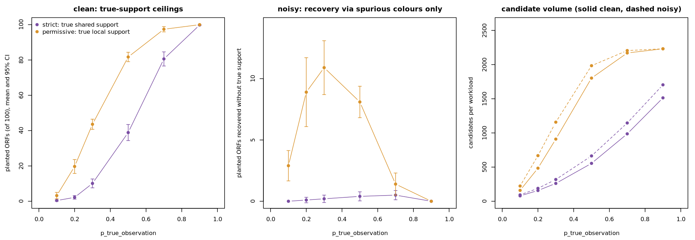
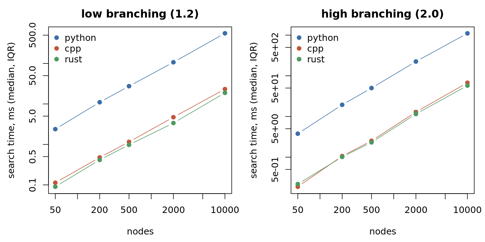
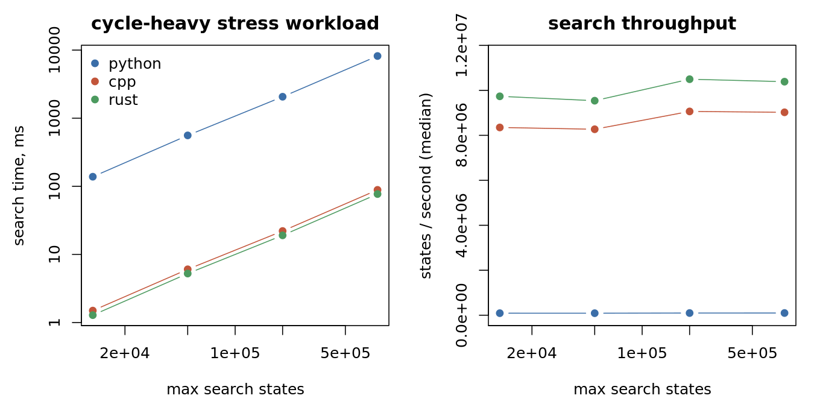

# ColorFrame — Technical Report (v1.0.1)

Project lead: Ali Mohammadi · 2026-11-15 · Spec v1.1 · Supersedes the v1.0.0 report
(`archive/v1.0.0/TECHNICAL_REPORT.md`); changes are explained in `REMEDIATION_REPORT.md`.

Authoritative data: `results/modal/20261115T065950Z` (commit `cb50ddc`, clean tree; Modal, 1 CPU,
4 GiB, Debian, Python 3.12.10, GCC 12.2.0, Rust 1.99.1). Analysis:
`reports/figures/modal_20261115T065950Z/`.

## 1. Question and positioning

Single-cell metagenomics can sequence up to about one million bacterial cells per experiment,
each yielding a sparse, incomplete genome. That raises algorithmic questions about walking a
coloured sequence graph: following branches, handling loops and the reading frame, and deciding
when evidence from different cells may be combined. ColorFrame studies a simplified, fully
specified version of that traversal.

It is a **controlled algorithmic and engineering prototype**, not a gene caller. ggCaller
(Horsfield et al. 2023) already pairs in-frame stop codons by DFS on a Bifrost DBG, validates
walks against an FM-index of the inputs, and scores starts using translation-initiation context,
colour sharing and orthologue consistency. ColorFrame has none of these (`PRIOR_ART_AND_SCOPE.md`).

## 2. Method

**Model** (`ALGORITHM_SPEC.md`). Nodes carry DNA and colour sets; edges share one overlap `K`.
A depth-first search starts at every owned position whose local bases are a prefix of `ATG`. The
frame is derived from the spelled length, and a walk ends at the first in-frame stop. Bounds on
ORF length, walk length, visits per node and states make the search finite; every cut is counted
and reported (`exhaustive = 0`). Policies:
- **strict**: some colour must be shared by every node so far;
- **permissive**: every node must have some colour. Candidates without a shared colour are
  labelled `fragmented_support`.

Loops need no special case: a loop whose spelled length is not divisible by 3 shifts the frame
on each pass (fixture G11).

**Verification.**
- 39 hand-derived conformance cases, checked against an independent brute-force oracle; all
  three implementations pass byte for byte.
- A timing-phase contract test, 12 RQ1 model tests and 4 peak-RSS measurement tests, all re-run
  inside the benchmark container.
- Byte-identical outputs across languages on all 134 generated workloads before any timing.

**Benchmark protocol** (`BENCHMARK_PROTOCOL.md`).
- Phases, identical in all three implementations: `parse, validate, search, canonicalize, write,
  total`. `search` contains no sorting, formatting or I/O. `--policy both` runs strict, then
  permissive.
- 2 warm-up and 7 measured runs per implementation and workload, in seeded random order;
  median and IQR.
- Peak RSS through a `/usr/bin/time` wrapper. Floor 2.9 MB (`true`); Python interpreter baseline
  13.9 MB.
- The workloads are synthetic. Inputs for the perf and stress families are byte-identical to
  v1.0.0.

**RQ1 design** (D-021).
- 10 replicates. Each fixes topology, sequences, 100 planted 3-node ORFs and 4 true samples per
  ORF.
- `p_true_observation` ∈ {0.1, 0.2, 0.3, 0.5, 0.7, 0.9}. Clean: `p_spurious_colour = 0`. Noisy:
  `0.25·p`, adding only non-true samples.
- Common random numbers: observed sets are nested across p, and noisy = clean + noise.
- Evaluation uses each ORF's true samples. Strict's ceiling is true *shared* support; permissive's
  is true *local* support.

## 3. Results

### RQ1 — support policies (synthetic ground truth; mean and exploratory 95% t-interval over 10 replicates)

| p | strict ceiling (true shared) | permissive ceiling (true local) | candidates strict / permissive (clean) | noisy: retained via spurious colours only, strict / permissive |
|---:|---:|---:|---:|---:|
| 0.1 | 0.4 [0.0, 0.8] | 3.2 [1.4, 5.0] | 79 / 159 | 0.0 / 2.9 [1.7, 4.1] |
| 0.2 | 2.2 [1.2, 3.2] | 19.7 [15.8, 23.6] | 157 / 484 | 0.1 / 8.9 [6.1, 11.7] |
| 0.3 | 10.1 [7.6, 12.6] | 43.6 [40.7, 46.5] | 261 / 909 | 0.2 / 10.9 [8.7, 13.1] |
| 0.5 | 38.9 [34.4, 43.4] | 81.7 [79.0, 84.4] | 554 / 1802 | 0.4 / 8.1 [6.8, 9.4] |
| 0.7 | 80.6 [76.6, 84.6] | 97.4 [95.9, 98.9] | 987 / 2170 | 0.5 / 1.4 [0.5, 2.3] |
| 0.9 | 99.8 [99.5, 100.1] | 100.0 | 1513 / 2231 | 0.0 / 0.0 |



- **The search loses nothing.** In all 240 (workload, policy) runs, recovered planted ORFs equal
  the policy's true-support ceiling. The policy and the evidence decide; the bounds don't.
- **Trade-off.** At sparse observation, path-coherent support (strict) is rare: 10% of planted
  ORFs at p = 0.3. Local support (permissive) covers 44%, at 3.5× the candidate volume.
- **Robustness to spurious colours.** With noise, permissive retains up to 10.9 planted ORFs
  whose local support exists only through spurious colours. Strict retains at most 0.5, because a
  single spurious colour rarely spans a whole path.
- **Caveats.** This is synthetic recovery under a simple independent-observation model, and no
  candidate is a validated gene. Intervals are exploratory, and the lower bounds near zero come
  from t-intervals on near-zero counts.

### RQ2 — implementations (median `search_ms`; speed-up = ratio of unrounded medians, `speedup.tsv`)

| Workload | Python | C++17 | Rust | C++ × | Rust × |
|---|---:|---:|---:|---:|---:|
| perf_n50_low | 2.38 ms | 0.11 ms | 0.09 ms | 21.1 | 26.5 |
| perf_n500_high | 50.0 ms | 2.52 ms | 2.31 ms | 19.8 | 21.6 |
| perf_n10000_high | 1104 ms | 67.5 ms | 57.5 ms | 16.4 | 19.2 |
| rq1_r00_p50_clean | 48.1 ms | 2.37 ms | 2.18 ms | 20.3 | 22.1 |
| stress_s800000 | 8186 ms | 88.7 ms | 77.0 ms | 92.3 | 106.3 |

Across all 20 timed workloads:
- **Search phase:** C++ is 16–30× and Rust 17–42× faster than Python on graph workloads, and
  92–108× on stress. Rust is faster than C++ on 19 of 20.
- **All in-process phases** (`total_ms`): C++ 3.7–9.5× and Rust 8.6–12.4× on the perf graphs.
  The gap narrows because parsing, validation, sorting and serialisation are a larger share there.
- **End-to-end** on small inputs is dominated by start-up: Python `wall_ms` is 45.9 ms on
  perf_n50_low against a 2.4 ms search.
- **Variability:** 35 of 60 rows have a relative search IQR below 3%; the maximum is 23%, on
  sub-millisecond searches.

These are comparisons of **these idiomatic implementations under one semantic contract**: Python
`frozenset`, C++ sorted vectors with `std::set_intersection`, Rust sorted vectors with a custom
merge (`ALGORITHM_SPEC.md` §5a). They are not claims about the languages in general.

### RQ3 — trade-offs




- **Size:** search time grows roughly linearly with node count on these acyclic, locally connected
  graphs. Random sequence has a stop codon about every 21 codons, so most walks are short.
- **State limit:** on the stop-free, cycle-rich stress graph, time is linear in the limit at a
  constant throughput: Python 0.10, C++ 9.0, Rust 10.4 million states/s. The limit is a direct
  time-versus-completeness knob, and the output reports when it was used.
- **Peak RSS (Linux, whole process, wrapper floor 2.9 MB):**

  | Workload | Python | C++17 | Rust |
  |---|---:|---:|---:|
  | stress_s800000 | 16.6 MB | 6.7 MB | 4.7 MB |
  | perf_n500_high | 20.8 MB | 9.5 MB | 6.4 MB |
  | perf_n10000_high (56 264 candidates) | 107.1 MB | 74.6 MB | 58.9 MB |

  Traversal state is small. Memory is dominated by the interpreter baseline (Python 13.9 MB) and
  by stored candidates on large outputs.

### AI-assisted development (descriptive only)

The token ledger is incomplete. Several agent legs were cut off without usage data, and Opus
usage is not exposed. Each implementation has a single development episode. Recorded completed
legs total 109k (Python), 117k (C++) and 126k (Rust) tokens. No relationship to performance or
code quality is claimed (`TOKEN_ACCOUNTING.md`). The process evidence that does stand: the tests
caught two fixture errors, the generator review caught a stop-codon defect, and the independent
review caught two measurement flaws and one evidence-accounting flaw, all fixed with regression
tests.

## 4. Limitations

See `LIMITATIONS.md`. Most important:
- Colours are local evidence. Without path validation of the kind ggCaller's FM-index provides,
  even strict support does not show that a walk exists in any one cell.
- Synthetic data only, with sorted vertex ids. Ordering sensitivity was not tested (Mehrotra et
  al. 2024).
- One hardware configuration, whose CPU model the sandbox does not report.
- RQ1 is a simple independent-observation model.

## 5. Reproduction

```bash
make test
modal run --detach benchmarks/modal_app.py
```
